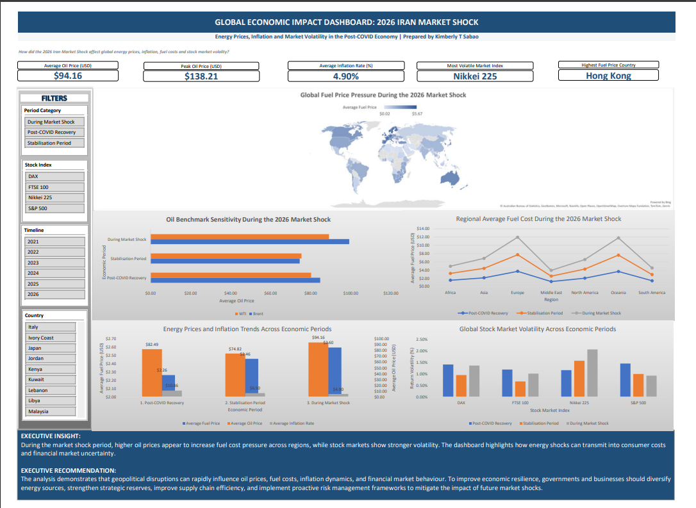

# Economic Impact of the 2026 Iran Market Shock Dashboard

## Project Overview

This Excel dashboard analyzes the economic impact of the 2026 Iran Market Shock on global oil prices, fuel costs, inflation and stock market volatility across different economic periods.

The project was developed to demonstrate data cleaning, Power Query, Pivot Tables, KPI calculations, dashboard design and business insight generation.

## Business Question

How did the 2026 Iran Market Shock affect global energy prices, fuel costs, inflation and stock market volatility across different economic periods?

## Dashboard Preview

## Tools Used

- Microsoft Excel
- Power Query
- Pivot Tables
- Pivot Charts
- KPI Cards
- Dashboard Design
- Data Cleaning
- Data Analysis

## Data Sources

- U.S. Energy Information Administration (EIA) – Brent and WTI crude oil prices
- Investing.com – Global stock market indices
- IMF International Financial Statistics (IFS) – Inflation data
- GlobalPetrolPrices.com – Petrol and diesel prices
- ExchangeRate API – Foreign exchange rates

## Key Findings

1. Average oil prices increased significantly during the Market Shock period.
2. Fuel prices rose across most regions, with Europe and Oceania experiencing the highest average fuel costs.
3. Higher oil prices appeared to increase fuel cost pressure across regions.
4. Stock market volatility increased during the shock period, with the Nikkei 225 showing the highest volatility.
5. Fuel price impacts varied across countries, with Hong Kong recording the highest average fuel price.

## Executive Recommendation

The analysis shows that geopolitical disruptions can rapidly influence oil prices, fuel costs, inflation dynamics and financial market behaviour.

To improve economic resilience, governments and businesses should diversify energy sources, strengthen strategic reserves, improve supply chain efficiency and implement proactive risk management frameworks.

## Files Included

| File | Description |
|---|---|
| Iran Economic Impact Dashboard 2026.xlsx | Main Excel workbook |
| Dashboard.pdf | Final dashboard view |
| Project Overview.pdf | Project summary and business context |
| Data Dictionary.pdf | Dataset definitions, assumptions and limitations |
| KPI Calculations.pdf | KPI calculation sheet |
| Pivot Analysis.pdf | Pivot tables, charts, insights and recommendations |

## Skills Demonstrated

- Data cleaning and transformation
- KPI development
- Pivot table analysis
- Dashboard design
- Business storytelling
- Data documentation
- Analytical thinking
